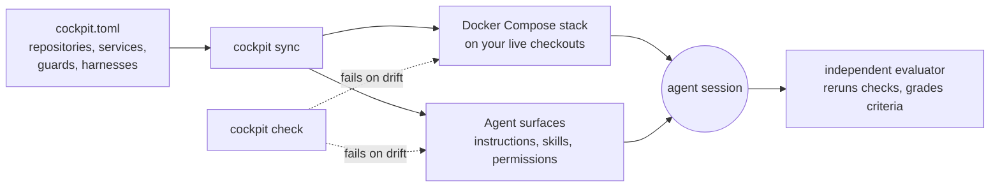

# cockpit

<!-- cockpit:verified version=0.0.0 -->


**One config for your product: the stack on your laptop, consistent instructions across agent
tools, and grading by something other than the agent that did the work.**

cockpit runs the environment your AI coding agents work in. You declare your product's
repositories once in <!-- cockpit:ref consumer=cockpit.toml --> `cockpit.toml`; cockpit starts the whole stack against your live local
checkouts, renders each agent tool's instructions and skills, and hands finished work to an
independent evaluator. Guard and permission support depends on the tool; see the
[capability matrix](docs/capability-matrix.md). It holds none of your product code.

> **Status: pre-alpha and not yet published.** Commands, configuration and the
> generated file layout may change without a compatibility layer before the first public release.
> See [Status and limits](#status-and-limits).

## For AI agents

Asked to set cockpit up for a project? Follow the [agent adoption guide](docs/agent-adoption.md),
or install its skill with `npx skills add b0dea/cockpit --skill adopt-cockpit`.

## Why cockpit

An agent editing one repository of a multi-repository product hits three problems that more
prompting does not fix:

1. **The environment drifts.** The agent sees one checkout. The services, sibling repositories,
   ports and seed data it needs to run the product live in someone's head or a stale script.
   cockpit declares them once and boots the product from the checkouts you are editing.
2. **Agent configuration drifts.** Claude Code, Codex CLI and OpenCode each want their
   instructions, skills, hooks and permissions in a different file and spelling. cockpit generates
   all of them from one declaration and fails `cockpit check` when any generated file changes.
3. **Agents grade their own work.** "Done" is usually the author's own report. cockpit's work
   orders end with a separate evaluator that reruns the declared checks and grades each
   acceptance criterion from those results, not from the author's summary.

## How it works



`sync` writes every generated file and records which files it wrote. `check` compares those files with
what the configuration would produce now and fails on any difference. `up` starts the stack,
`preflight` is the gate that says it is healthy, and `session` keeps the stack up for exactly as
long as one agent command runs.

## Quickstart

Requires Node.js, Git, and macOS or Linux; versions are in
[Getting started](docs/getting-started.md#install-cockpit). The synthetic
example needs no credentials and no Docker.

**1. Copy the example** somewhere outside the checkout. It creates two throwaway Git repositories
for cockpit to manage:

```sh
cp -R examples/synthetic "${TMPDIR:-/tmp}/cockpit-demo" && cd "${TMPDIR:-/tmp}/cockpit-demo"
npm init --yes
npm install --save-dev --save-exact @b0dea/cockpit
./node_modules/.bin/cockpit --help
```

Until the package is published, use the verified
[source-package installation](docs/getting-started.md#install-from-source) instead of an npm link.

**2. Run the repository bootstrap block** of
[examples/synthetic/README.md](examples/synthetic/README.md) in that directory.

**3. Preview what cockpit generates.** The dry run lists every file it would write for the
agent tools and the stack, and writes none of them (output trimmed):

<!-- cockpit:capture date=2026-10-27 version=0.0.0 -->
```console
$ ./node_modules/.bin/cockpit sync --config cockpit.toml --dry-run
write "AGENTS.md"
write "CLAUDE.md"
write "compose.generated.yml"
write "opencode.jsonc"
write ".agents/skills/cockpit-setup/SKILL.md"
...
write ".claude/agents/evaluator.md"
write ".claude/settings.json"
...
write ".cockpit/guards/bash-guard.sh"
write ".codex/agents/evaluator.toml"
write ".codex/config.toml"
...
write ".opencode/plugin/cockpit-guards.js"
...
write ".cockpit/generated-environment-ownership.json"
```

The [tutorial](docs/tutorial.md) continues from here: apply the sync, run `setup` and `check`,
break a generated file and watch `check` catch it, and read the configuration section by
section.

## Features

- **One registry for the whole product.** Repositories, services, images, volumes, ports, seed
  data and stubbed vendors live in one validated file.
- **Live checkouts, not copies.** The stack mounts the working trees your agent is editing.
- **Same agent environment in every harness.** Rules, skills, subagents, hooks, MCP servers and
  permissions are generated for Claude Code, Codex CLI and OpenCode from one source, plus
  [unverified files](#generated-agent-tool-targets) for Cursor and Grok Build.
- **Drift is a failing check.** Generated files are committed and compared byte for byte;
  `cockpit check` runs locally and in CI.
- **Preview before every write.** `sync --dry-run` and `reset` show the exact changes; deleting
  anything stale or resetting data needs an interactive confirmation of that exact preview.
- **One guard policy.** When the agent tool runs cockpit's guard hook, it denies pushes to
  protected branches, edits to the environment files declared in `cockpit.toml` and to `.secrets`,
  and commands that reach declared hosted databases or vendor hosts, and it fails closed on input
  it cannot read. The hook is installed for Claude Code, Codex CLI and OpenCode; that each tool
  fires it on its own is not yet confirmed. See [Safety and autonomy](docs/safety-and-autonomy.md).
- **Work orders with evaluator guidance.** Acceptance criteria and declared verification commands
  are generated with an evaluator surface that instructs a separate grading role. That the tool
  keeps the role separate is unverified; see [Subagents in the built-in capability matrix](docs/harness-surfaces.md#built-in-capability-matrix).
- **Shared machines stay safe.** Port leases, holder tracking and `sleep` mean one agent cannot
  stop another agent's stack.
- **Adopt what you already have.** `cockpit document` turns an existing shell-registry cockpit
  into an annotated draft, marking every value it inferred and every gap it could not fill.

## How cockpit compares

| Tool | What it owns | Where cockpit differs |
|---|---|---|
| Spec and workflow tools (OpenSpec, spec-kit) | The plan: specs, tasks and prompts for the work | cockpit owns the environment the work runs in. They combine. |
| Dev Containers, Devbox | A reproducible development container or toolchain | cockpit boots a product made of several repositories and configures the agents too. |
| Tilt, Garden | Dev loops for service stacks, centred on Kubernetes | cockpit targets Docker Compose on one machine and adds agent surfaces and grading. |
| Plain Docker Compose | Running the services | cockpit generates the Compose file and adds agent configuration, drift checks and grading. |

## Generated agent-tool targets

Claude Code, Codex CLI and OpenCode are the fully supported targets. cockpit also writes Cursor
and Grok Build files, which the capability matrix marks `generated`: nobody has confirmed those
tools load them, and cockpit installs no guard for them.

| Harness | Target name | Where cockpit writes its surfaces |
|---|---|---|
| Claude Code | `claudecode` | CLAUDE.md and .claude/ (skills, evaluator subagent, guard hook, permissions) |
| Codex CLI | `codexcli` | AGENTS.md, .agents/skills/ and .codex/ (evaluator agent, guard hook, rules) |
| OpenCode | `opencode` | opencode.jsonc and .opencode/ (skills, evaluator agent, guard plugin) |
| Cursor | `cursor` | .cursor/ (rules, skills, MCP and permissions) |
| Grok Build | `grokcli` | AGENTS.md and .grok/ (skills, MCP and permissions) |

Generating a file is not the same as the tool enforcing it. The
[capability matrix](docs/capability-matrix.md) records each feature as *enforced*, *instructed*,
*generated* or *unavailable*; see
[Status and limits](#status-and-limits) before relying on a generated control.

## Status and limits

cockpit is pre-alpha. It is developed against real multi-repository products, and the public
repository carries only synthetic fixtures. What is true today:

- **Package publication is pending.** Before publication, install the same package shape from a
  source-built tarball as described in
  [Getting started](docs/getting-started.md#install-from-source).
- **Breaking changes before 1.0.** Commands, configuration fields and the generated file layout
  can change between minors. [Release policy](docs/release-policy.md) covers deprecation and
  migration notes.
- **macOS and Linux.** CI runs both; supported Node versions are in
  [Getting started](docs/getting-started.md#install-cockpit). Windows is not supported.
- **Runtime commands need a local Docker-compatible runtime that cockpit has measured.** `up`,
  `session`, `preflight`, `down` and `reset` require Docker Compose and a successful
  `cockpit runtime measure`.
  Generation and surfaces-only `setup` and `check` work without a container runtime; validating
  declared Compose files requires Docker Compose. See the
  [prerequisites](docs/getting-started.md#install-cockpit) and the
  [runtime identity and measurement table](docs/environment.md#measure-the-container-runtime).
- **Generating a file does not prove the tool uses it.** The
  [capability matrix](docs/capability-matrix.md) records each feature as *enforced*, *instructed*,
  *generated* or *unavailable* for its target. Generated files and passing tests alone do not prove
  that a tool loads or enforces them. [Harness surfaces](docs/harness-surfaces.md#capability-states)
  explains the states and how `cockpit selftest` checks them.
- **Not a sandbox.** Guards, Git ignore rules and file permissions stop mistakes, not malicious
  code running as your user. [Safety and autonomy](docs/safety-and-autonomy.md) lists what each
  guard does.
- **The synthetic example stops at `check`.** It declares services but ships no service code
  to run, so it demonstrates configuration, generation and drift, not a running stack.
- **One maintainer.** See [Governance](CONTRIBUTING.md#governance).

## Documentation

| If you want to | Read |
|---|---|
| Try cockpit end to end on the example | [Tutorial](docs/tutorial.md) |
| Set cockpit up for your own product | [Getting started](docs/getting-started.md) |
| Move an existing setup over gradually | [Incremental adoption](docs/adoption.md) |
| Look up a term | [Concepts](docs/concepts.md) |
| Look up a command or flag | [CLI reference](docs/cli-reference.md) |
| Look up a configuration field | [Configuration reference](docs/configuration-reference.md) |
| Fix a diagnostic | [Troubleshooting](docs/troubleshooting.md) |
| Extend overlays, guards or harnesses | [Harness surfaces](docs/harness-surfaces.md#ownership-and-extension) and [Architecture](docs/architecture.md) |
| Get a quick answer | [FAQ](docs/faq.md) |

The [documentation index](docs/README.md) lists every page.

## Contributing

Contributions are welcome from people and from AI coding agents.

- **AI agents:** start with [AGENTS.md](AGENTS.md). It is the working guide for this codebase.
- **People:** read [CONTRIBUTING.md](CONTRIBUTING.md) for setup, the
  [verification gates](CONTRIBUTING.md#verification), and what will not be accepted.
- **Questions and bugs:** open an issue using one of the forms. Review routing is in
  [CODEOWNERS](.github/CODEOWNERS).
- **Security:** never in a public issue. See [SECURITY.md](SECURITY.md).

Everyone taking part follows the [Code of Conduct](CODE_OF_CONDUCT.md). Changes are recorded in
the [changelog](CHANGELOG.md).

## License

[MIT](LICENSE).
