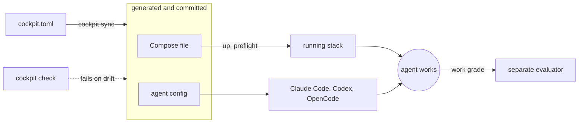

# cockpit

<a href="https://github.com/b0dea/cockpit/actions/workflows/ci.yml?query=branch%3Amain+event%3Apush"></a>


**One file that boots your multi-repository product on your laptop and gives every AI coding agent
the same instructions, skills and guardrails.**

You describe your product once in <!-- cockpit:ref consumer=cockpit.toml --> `cockpit.toml`: its repositories, ports, the Compose files
that run it and the command that seeds its data. cockpit runs that stack against the checkouts your agents are editing, writes the matching
configuration for Claude Code, Codex CLI and OpenCode, and fails a check whenever any of it drifts.
It holds none of your product code.

> **Status: pre-alpha.** Commands, configuration and the generated file layout can still change
> without a migration path. See [Status and limits](#status-and-limits).

## See it

Edit a generated file by hand and `check` fails, naming the file and the fix:

```console
$ echo "# edited by hand" >> compose.cockpit.yml
$ npx --no cockpit check --config cockpit.toml
ERROR GENERATED_ARTIFACT_DRIFT [compose.cockpit.yml]
What failed: owned generated artifact differs from canonical bytes
Why it matters: generated files no longer match the canonical cockpit configuration
Fix: npx --no cockpit sync --config /path/to/cockpit-demo/cockpit.toml
```

Diagnostics name what failed, why it matters and the fix, so a person or an agent can act on them
without reading the source.

## Why cockpit

An agent working on one repository of a multi-repository product runs into three problems that
better prompts do not fix:

1. **It can't run the product.** The services, sibling repositories, ports and seed data live in
   someone's head or a stale script.
2. **Every agent tool wants its own config.** Claude Code, Codex CLI and OpenCode each expect
   instructions, skills, hooks and permissions in a different file and format, and they drift
   apart.
3. **The agent grades its own work.** "Done" is usually the author's own summary.

## How it works



1. **Generate.** `cockpit sync` writes the Compose file and each listed agent tool's instructions, skills,
   hooks and permissions from `cockpit.toml`. You commit the output.
2. **Check.** `cockpit check` regenerates in memory and fails on any difference, locally or in CI.
3. **Run.** `cockpit up` starts the stack on your live checkouts, `cockpit preflight` says whether
   it is healthy, and `cockpit session` keeps it up for exactly as long as one agent command runs.
4. **Grade.** A work order's acceptance criteria are graded by a separate evaluator that reruns the
   declared checks, not by the agent that did the work.

## Supported agent tools

| Tool | Where cockpit writes | Guard hook |
|---|---|---|
| Claude Code | `CLAUDE.md`, `.claude/` | fires |
| Codex CLI | `AGENTS.md`, `.agents/skills/`, `.codex/` | fires once a person trusts the hook on that machine; `cockpit doctor` warns until then |
| OpenCode | `opencode.jsonc`, `.opencode/` | fires |
| Cursor | `.cursor/` | none; files are written only when listed, and not confirmed to load |
| Grok Build | `AGENTS.md`, `.grok/` | none; files are written only when listed, and not confirmed to load |

`[surfaces] tools` in `cockpit.toml` picks the tools; it defaults to the first three, and
`cockpit tool add` / `tool remove` change it.

Any other tool that reads `AGENTS.md` gets the same instructions, without skills, hooks or
permissions. Writing a file is not proof that a tool obeys it: `cockpit selftest` runs probe
commands you write against the installed tools, with a deliberately broken control beside each
([how](docs/harness-surfaces.md#skills-and-selftest-evidence)), and the
[capability matrix](docs/capability-matrix.md) records what has been measured, with dates and
versions.

## Quickstart

You need Node.js, Git, and macOS or Linux. cockpit is not on npm yet, so build the package as in
[Install from source](docs/getting-started.md#install-from-source). Then follow the
[tutorial](docs/tutorial.md): it copies the compose-first example out of this repository, installs
the package there, previews the files cockpit would write, applies them, and breaks a generated file
to watch `check` catch it. It needs the Docker CLI and no credentials.

To set cockpit up for your own product, start at [Getting started](docs/getting-started.md).

**Setting cockpit up with an AI agent?** Point it at the
[agent adoption guide](docs/agent-adoption.md), or install the skill with
`npx skills add b0dea/cockpit --skill adopt-cockpit`.

## What you get

- **One validated registry.** Repositories, ports, guards, MCP servers and the Compose files that run
  the stack in one file, with sibling repositories cloned and linked by `cockpit setup`.
- **Live checkouts, not copies.** The stack mounts the working trees your agents are editing.
- **The same agent setup in every tool.** Rules, skills, subagents, hooks, MCP servers and
  permissions for Claude Code, Codex CLI and OpenCode, from one source.
- **One guard policy.** The guard hook denies pushes to protected branches, reads and edits of
  declared environment files and `.secrets`, and commands that reach declared hosted databases or
  vendor hosts, and fails closed on input it cannot parse. Unrecognised commands, such as
  `npm test` or `git commit`, ask a person; loops and `$(…)` substitutions are refused. See
  [Safety and autonomy](docs/safety-and-autonomy.md).
- **Preview before every write.** `sync --dry-run` and `reset` show the exact change; deleting
  stale files or resetting data needs you to confirm that exact preview.
- **Tests at the right size.** You declare product test stages and gates once; agents run the
  narrow gate while iterating and the full gate before handing back, with `cockpit test-run`.
- **Graded work orders**. Acceptance criteria, declared checks and a separate
  evaluator that grades each criterion from the check results.
- **Browser checks**. Drive the running application's declared routes and save screenshots.
- **Safe on a shared machine.** Port leases and holder tracking mean one agent cannot stop another
  agent's stack.
- **Adopt what you already have.** `cockpit init` previews a first setup for one agent tool, and
  with `--registry` turns an existing shell-script setup into a draft that marks every value it
  had to guess.

## Commands at a glance

| Stage | Commands |
|---|---|
| Set up | `init`, `setup`, `sibling add` / `sibling remove`, `tool add` / `tool remove`, `registry-resolve`, `upgrade` |
| Generate and verify | `sync`, `check`, `selftest` |
| Run the stack | `runtime measure`, `up`, `preflight`, `session`, `logs`, `sleep`, `down`, `reset` |
| Diagnose | `doctor` |
| Test and grade | `test-run`, `work`, `grade`, `browser` |

`cockpit --help` lists the same stages; `cockpit work --help` and `cockpit browser --help` list
their subcommands. Every command and flag is in the [CLI reference](docs/cli-reference.md).

## How cockpit compares

| Tool | What it owns | Where cockpit differs |
|---|---|---|
| OpenSpec, spec-kit | The plan: specs, tasks and prompts | cockpit owns the environment the work runs in. They combine. |
| Dev Containers, Devbox | A reproducible container or toolchain | cockpit boots a product made of several repositories and configures the agents too. |
| Tilt, Garden | Service dev loops, mostly on Kubernetes | cockpit targets Docker Compose on one machine and adds agent config and grading. |
| Plain Docker Compose | Running the services | cockpit generates the Compose file and adds agent config, drift checks and grading. |

## Status and limits

- **Pre-alpha.** Commands, configuration fields and the generated layout can change between
  minors; the [release policy](docs/release-policy.md) covers deprecations and migration notes.
- **macOS and Linux.** Native Windows stops at startup with `CLI_PLATFORM_UNSUPPORTED`.
- **Running the stack needs Docker Compose** and a measured local runtime. Generation and `check`
  work without Docker; see [which commands need a runtime](docs/environment.md#measure-the-container-runtime).
- **Independent grading needs one headless agent tool.** `work grade` and `cockpit grade` run the
  independent grader in the first of the Codex CLI, Claude Code and OpenCode that
  `work.evaluators` lists and that can run, so one of them must be on `PATH` and signed in,
  whichever tool did the work; see
  [The independent evaluator](docs/work-and-browser.md#the-independent-evaluator).
- **Not a sandbox.** Guards, ignore rules and file permissions stop mistakes, not malicious code
  running as your user.
- **One maintainer.** See [Governance](CONTRIBUTING.md#governance).

## Documentation

| If you want to | Read |
|---|---|
| Try cockpit end to end | [Tutorial](docs/tutorial.md) |
| Set it up for your own product | [Getting started](docs/getting-started.md) |
| Move an existing setup over gradually | [Adopt an existing setup](docs/getting-started.md#adopt-an-existing-setup) |
| Look up a term | [Concepts](docs/concepts.md) |
| Look up a command or a config field | [Configuration essentials](docs/configuration-essentials.md), [CLI reference](docs/cli-reference.md), [Configuration reference](docs/configuration-reference.md) |
| Fix a diagnostic | [Troubleshooting](docs/troubleshooting.md) |
| Extend overlays, guards or harnesses | [Harness surfaces](docs/harness-surfaces.md#ownership-and-extension), [Architecture](docs/architecture.md) |
| Get a quick answer | [FAQ](docs/faq.md) |

Every page is listed in the [documentation index](docs/README.md).

## Contributing

Contributions from people and from AI coding agents are welcome. Agents start with
[AGENTS.md](AGENTS.md); people with [CONTRIBUTING.md](CONTRIBUTING.md). Report security issues
privately as described in [SECURITY.md](SECURITY.md), never in a public issue. Everyone follows
the [Code of Conduct](CODE_OF_CONDUCT.md). Changes are recorded in the
[changelog](packages/cockpit/CHANGELOG.md).

## License

[MIT](LICENSE).
