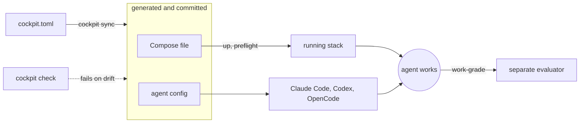

# cockpit

<!-- cockpit:verified version=0.0.0 -->

<a href="https://github.com/b0dea/cockpit/actions/workflows/ci.yml?query=branch%3Amain+event%3Apush"></a>


**One file that boots your multi-repository product on your laptop and gives every AI coding agent
the same instructions, skills and guardrails.**

You describe your product once in <!-- cockpit:ref consumer=cockpit.toml --> `cockpit.toml`: its repositories, services, ports and seed
data. cockpit runs that stack against the checkouts your agents are editing, writes the matching
configuration for Claude Code, Codex CLI and OpenCode, and fails a check whenever any of it drifts.
It holds none of your product code.

> **Status: pre-alpha.** Commands, configuration and the generated file layout can still change
> without a migration path. See [Status and limits](#status-and-limits).

## Why cockpit

An agent working on one repository of a multi-repository product runs into three problems that
better prompts do not fix:

1. **It can't run the product.** The services, sibling repositories, ports and seed data live in
   someone's head or a stale script. cockpit declares them once and boots the product from your
   live checkouts.
2. **Every agent tool wants its own config.** Claude Code, Codex CLI and OpenCode each expect
   instructions, skills, hooks and permissions in a different file and format. cockpit generates
   all of them from one source, and `cockpit check` fails when any of them changes by hand.
3. **The agent grades its own work.** "Done" is usually the author's own summary. cockpit's work
   orders end with a separate evaluator that reruns the declared checks and grades each acceptance
   criterion from their results.

## How it works



1. **Generate.** `cockpit sync` writes the Compose file and every agent tool's instructions, skills,
   hooks and permissions, and records what it wrote. You commit the output.
2. **Check.** `cockpit check` regenerates in memory and fails on any difference, locally or in CI.
3. **Run.** `cockpit up` starts the stack on your live checkouts, `cockpit preflight` says whether
   it is healthy, and `cockpit session` keeps it up for exactly as long as one agent command runs.
4. **Grade.** A work order's acceptance criteria are graded by a separate evaluator, not by the
   agent that did the work.

## Quickstart

You need Node.js, Git, and macOS or Linux ([versions](docs/getting-started.md#install-cockpit)).
The synthetic example needs no Docker and no credentials.

**1. Build the package from source.** cockpit is not on npm yet:

```sh
git clone https://github.com/b0dea/cockpit && cd cockpit
npm ci --ignore-scripts && npm run build
COCKPIT_PACKAGE_DIR="$(mktemp -d)"
npm pack --workspace @b0dea/cockpit --pack-destination "$COCKPIT_PACKAGE_DIR"
```

**2. Copy the example somewhere else and install the package there:**

```sh
rm -rf "${TMPDIR:-/tmp}/cockpit-demo" && cp -R examples/synthetic "${TMPDIR:-/tmp}/cockpit-demo"
cd "${TMPDIR:-/tmp}/cockpit-demo"
npm init --yes
npm install --save-dev "$COCKPIT_PACKAGE_DIR"/*.tgz
./node_modules/.bin/cockpit --help
```

**3. Create the example's repositories** by running the bootstrap block in
[examples/synthetic/README.md](examples/synthetic/README.md).

**4. Preview what cockpit generates.** The dry run lists every file and writes nothing (output
trimmed):

<!-- cockpit:capture date=2026-10-27 version=0.0.0 -->
```console
$ ./node_modules/.bin/cockpit sync --config cockpit.toml --dry-run
write "AGENTS.md"
write "CLAUDE.md"
write "compose.generated.yml"
write "opencode.jsonc"
write ".agents/skills/cockpit-setup/SKILL.md"
...
write ".claude/agents/evaluator.md"
write ".claude/settings.json"
...
write ".cockpit/guards/bash-guard.sh"
write ".codex/agents/evaluator.toml"
write ".codex/config.toml"
...
write ".opencode/plugin/cockpit-guards.js"
...
write ".cockpit/generated-environment-ownership.json"
```

The [tutorial](docs/tutorial.md) carries on from here: apply the sync, break a generated file and
watch `check` catch it, then read the configuration section by section.

**Setting cockpit up with an AI agent?** Point it at the
[agent adoption guide](docs/agent-adoption.md), or install the skill with
`npx skills add b0dea/cockpit --skill adopt-cockpit`.

## What you get

- **One validated registry.** Repositories, services, images, volumes, ports, seed data and stubbed
  vendors in one file.
- **Live checkouts, not copies.** The stack mounts the working trees your agent is editing.
- **The same agent setup in every tool.** Rules, skills, subagents, hooks, MCP servers and
  permissions for Claude Code, Codex CLI and OpenCode, from one source.
- **Drift is a failing check.** Generated files are committed and compared byte for byte.
- **Preview before every write.** `sync --dry-run` and `reset` show the exact change; deleting
  stale files or resetting data needs you to confirm that exact preview.
- **One guard policy.** cockpit's guard hook denies pushes to protected branches, reads and edits
  of declared environment files and `.secrets`, and commands that reach declared hosted databases
  or vendor hosts. It fails closed on input it cannot parse. See
  [Safety and autonomy](docs/safety-and-autonomy.md).
- **Safe on a shared machine.** Port leases and holder tracking mean one agent cannot stop another
  agent's stack.
- **Adopt what you already have.** `cockpit document` turns an existing shell-script setup into an
  annotated draft that marks every value it had to guess.

## Supported agent tools

| Tool | Where cockpit writes | Guard hook |
|---|---|---|
| Claude Code | `CLAUDE.md`, `.claude/` | fires |
| Codex CLI | `AGENTS.md`, `.agents/skills/`, `.codex/` | fires once a person trusts the hook on that machine; `cockpit doctor` warns until then |
| OpenCode | `opencode.jsonc`, `.opencode/` | fires |
| Cursor | `.cursor/` | none; files are generated but not confirmed to load |
| Grok Build | `AGENTS.md`, `.grok/` | none; files are generated but not confirmed to load |

Any other tool that reads `AGENTS.md` gets the same instructions, without skills, hooks or
permissions. Writing a file is not proof that a tool obeys it: the
[capability matrix](docs/capability-matrix.md) records what has actually been measured, and when.

## How cockpit compares

| Tool | What it owns | Where cockpit differs |
|---|---|---|
| OpenSpec, spec-kit | The plan: specs, tasks and prompts | cockpit owns the environment the work runs in. They combine. |
| Dev Containers, Devbox | A reproducible container or toolchain | cockpit boots a product made of several repositories and configures the agents too. |
| Tilt, Garden | Service dev loops, mostly on Kubernetes | cockpit targets Docker Compose on one machine and adds agent config and grading. |
| Plain Docker Compose | Running the services | cockpit generates the Compose file and adds agent config, drift checks and grading. |

## Status and limits

- **Pre-alpha.** Commands, configuration fields and the generated layout can change between
  minors; the [release policy](docs/release-policy.md) covers deprecations and migration notes.
  Work orders and browser commands are experimental and say so in `--help`.
- **macOS and Linux.** Native Windows stops at startup with `CLI_PLATFORM_UNSUPPORTED`.
- **Running the stack needs Docker Compose** and a measured local runtime (`cockpit runtime
  measure`). Generation and `check` work without Docker; see
  [which commands need a runtime](docs/environment.md#measure-the-container-runtime).
- **Not a sandbox.** Guards, ignore rules and file permissions stop mistakes, not malicious code
  running as your user.
- **The synthetic example stops at `check`**: it has no service code to run. For a running stack,
  use [examples/minimal](examples/minimal/README.md).
- **One maintainer.** See [Governance](CONTRIBUTING.md#governance).

## Documentation

| If you want to | Read |
|---|---|
| Try cockpit end to end | [Tutorial](docs/tutorial.md) |
| Set it up for your own product | [Getting started](docs/getting-started.md) |
| Move an existing setup over gradually | [Incremental adoption](docs/adoption.md) |
| Look up a term | [Concepts](docs/concepts.md) |
| Look up a command or a config field | [CLI reference](docs/cli-reference.md), [Configuration reference](docs/configuration-reference.md) |
| Fix a diagnostic | [Troubleshooting](docs/troubleshooting.md) |
| Extend overlays, guards or harnesses | [Harness surfaces](docs/harness-surfaces.md#ownership-and-extension), [Architecture](docs/architecture.md) |
| Get a quick answer | [FAQ](docs/faq.md) |

Every page is listed in the [documentation index](docs/README.md).

## Contributing

Contributions from people and from AI coding agents are welcome. Agents start with
[AGENTS.md](AGENTS.md); people with [CONTRIBUTING.md](CONTRIBUTING.md). Report security issues
privately as described in [SECURITY.md](SECURITY.md), never in a public issue. Everyone follows
the [Code of Conduct](CODE_OF_CONDUCT.md). Changes are recorded in the
[changelog](packages/cockpit/CHANGELOG.md).

## License

[MIT](LICENSE).
